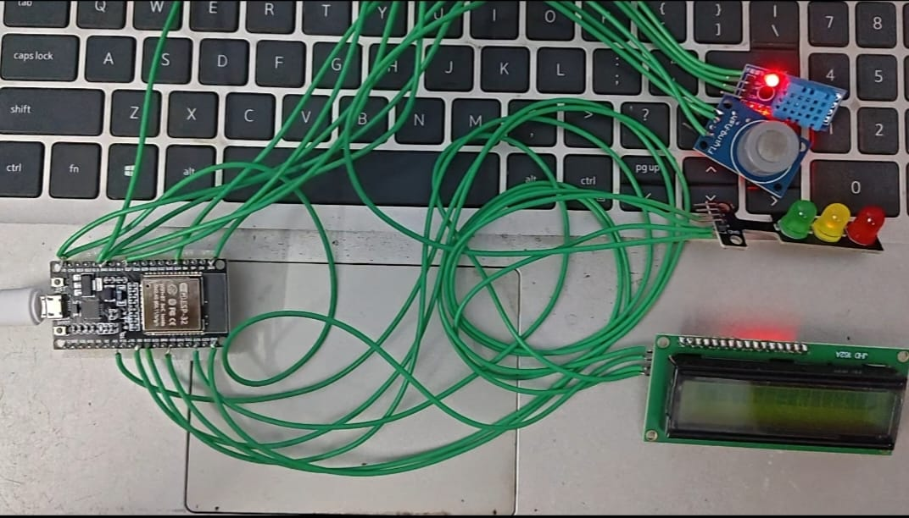
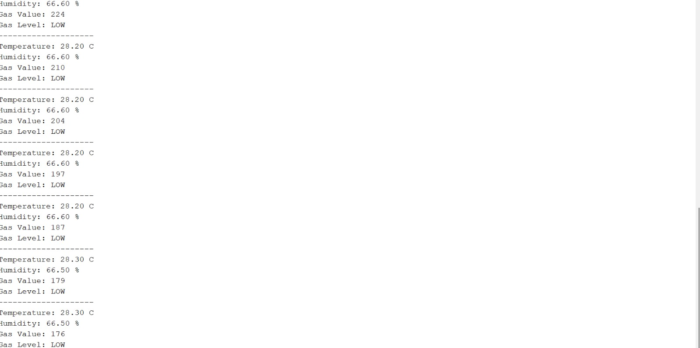

# ESP32 DHT11 and MQ-7 Gas Monitoring System

## Description
This project uses an ESP32, DHT11 temperature and humidity sensor, and MQ-7 gas sensor to monitor environmental conditions. The sensor readings are displayed on a 16x2 I2C LCD and printed on the Serial Monitor. It demonstrates basic sensor interfacing, real-time data monitoring, and embedded systems programming.

## Components Required
- ESP32 Development Board
- DHT11 Temperature and Humidity Sensor
- MQ-7 Gas Sensor Module
- 16x2 I2C LCD Display
- Red, Yellow, and Green LEDs
- Breadboard and Jumper Wires
- USB Cable

## Pin Connections

| Component | ESP32 GPIO |
|---|---|
| DHT11 Data | GPIO 27 |
| MQ-7 Analog Output | GPIO 34 |
| LCD SDA | GPIO 21 |
| LCD SCL | GPIO 22 |
| Red LED | GPIO 4 |
| Yellow LED | GPIO 5 |
| Green LED | GPIO 18 |

## Working Principle
1. The DHT11 measures temperature and humidity.
2. The MQ-7 sensor provides an analog reading related to the gas-sensing response.
3. The ESP32 reads the sensor values and displays them on the LCD.
4. The sensor readings and gas categories are printed on the Serial Monitor.
5. LEDs indicate the programmed gas-reading categories based on predefined ADC thresholds.

## Hardware Output

## Serial Monitor Output

## Demonstration Video

[Watch the Project Demonstration]()https://drive.google.com/file/d/1Cqo9mQwen_OWOwR0DrMXJtt5HmYwNacG/view?usp=drivesdk
## Software and Tools
- Arduino IDE
- ESP32 Board Package
- DHT Sensor Library
- LiquidCrystal_I2C Library

## Important Note
The gas readings are raw ADC values, not calibrated gas concentration measurements in ppm. The LOW, MEDIUM, and HIGH categories use predefined thresholds and are intended for demonstration only. Reliable gas concentration measurement requires appropriate sensor warm-up, calibration, and testing.

## Applications
- Basic environmental monitoring
- Sensor interfacing practice
- Embedded systems learning
- Real-time sensor data display

## Project Status
Completed — basic sensor readings are displayed on the LCD and Serial Monitor.
